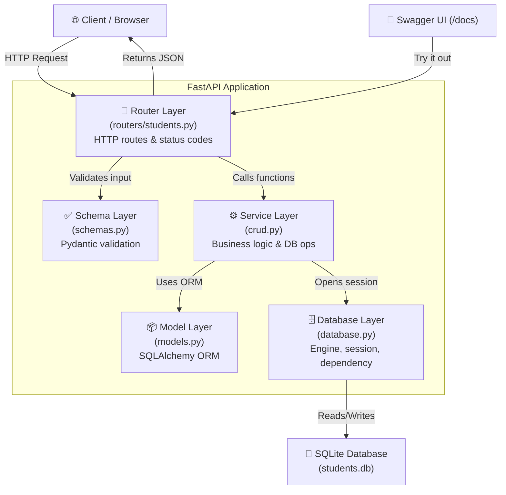
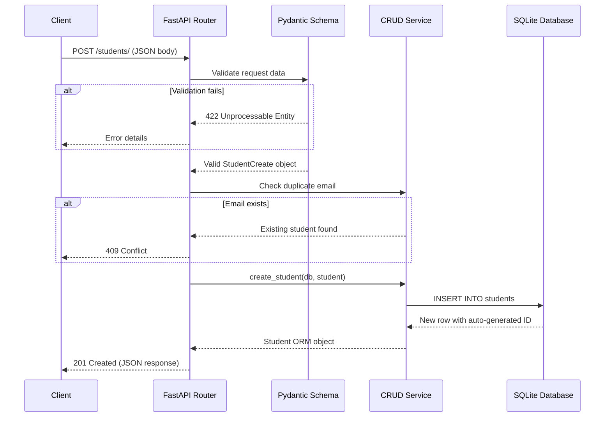

# 🎓 Student Management API

A professional **RESTful API** for managing student records, built with modern Python technologies. This project demonstrates clean architecture, comprehensive input validation, automated testing, and interactive API documentation.

[](https://www.python.org/)
[](https://fastapi.tiangolo.com/)
[](https://www.sqlalchemy.org/)
[](#-testing)
[](LICENSE)

---

## 📋 Table of Contents

- [Project Overview](#-project-overview)
- [Features](#-features)
- [Technology Stack](#-technology-stack)
- [Architecture](#-architecture)
- [Project Structure](#-project-structure)
- [Getting Started](#-getting-started)
- [API Documentation](#-api-documentation)
- [API Endpoints](#-api-endpoints)
- [Request & Response Examples](#-request--response-examples)
- [Error Handling](#-error-handling)
- [Database Design](#-database-design)
- [Input Validation Rules](#-input-validation-rules)
- [Pagination](#-pagination)
- [Testing](#-testing)
- [Future Improvements](#-future-improvements)
- [Author](#-author)

---

## 🔍 Project Overview

The Student Management API is a fully functional backend service that enables **Create, Read, Update, and Delete (CRUD)** operations on student records. It follows a layered architecture pattern — separating HTTP routing, business logic, data validation, and database access into distinct modules for maintainability and testability.

The API has been rigorously verified with **75 automated tests** and **58 live endpoint verification checks**, covering success paths, error handling, boundary conditions, and edge cases.

---

## ✨ Features

| Feature | Description |
|---|---|
| **Full CRUD Operations** | Create, retrieve, update, and delete student records |
| **Email Uniqueness** | Database-enforced unique constraint on email addresses |
| **Input Validation** | Pydantic-powered validation with meaningful error messages |
| **Partial Updates** | Update only the fields you need — unchanged fields are preserved |
| **Pagination** | Built-in `skip` and `limit` query parameters for large datasets |
| **Error Handling** | Proper HTTP status codes (201, 204, 404, 409, 422) with descriptive error details |
| **Interactive Documentation** | Auto-generated Swagger UI and ReDoc at `/docs` and `/redoc` |
| **Automated Testing** | 75 pytest tests with isolated in-memory databases |
| **Live Verification** | 58-check verification script using httpx |

---

## 🛠 Technology Stack

| Technology | Version | Purpose |
|---|---|---|
| **Python** | 3.12 | Core programming language |
| **FastAPI** | 0.162.0 | High-performance async web framework with automatic OpenAPI docs |
| **SQLAlchemy** | 2.1.8 | ORM for database operations using the modern 2.x declarative style |
| **SQLite** | Built-in | Lightweight file-based relational database |
| **Pydantic** | 2.14.3 | Data validation and serialization with Python type hints |
| **Uvicorn** | 0.54.0 | ASGI server to run the FastAPI application |
| **Pytest** | 9.2.0 | Testing framework with fixtures and assertions |
| **HTTPX** | 0.28.1 | Modern HTTP client for live API verification |
| **email-validator** | 2.3.0 | RFC-compliant email address validation |

---

## 🏗 Architecture

The project follows a **layered architecture** where each layer has a single responsibility:



### Request Flow



---

## 📂 Project Structure

```
student-management-api/
│
├── app/                          # Application package
│   ├── __init__.py               # Package marker
│   ├── main.py                   # FastAPI app instance, root endpoint, table creation
│   ├── database.py               # SQLAlchemy engine, session factory, get_db dependency
│   ├── models.py                 # ORM model — Student table definition
│   ├── schemas.py                # Pydantic schemas — request/response validation
│   ├── crud.py                   # Service layer — all database operations
│   └── routers/
│       ├── __init__.py           # Package marker
│       └── students.py           # HTTP routes for /students endpoints
│
├── tests/
│   └── test_students.py          # 75 automated tests (9 test classes)
│
├── live_verification.py          # 58-check live API verification script
├── requirements.txt              # Python dependencies (pinned versions)
├── PROJECT_PROGRESS.md           # Detailed project progress documentation
├── .gitignore                    # Git exclusion rules
└── students.db                   # SQLite database (auto-created, git-ignored)
```

---

## 🚀 Getting Started

### Prerequisites

- **Python 3.12+** — [Download from python.org](https://www.python.org/downloads/)
- **Git** — [Download from git-scm.com](https://git-scm.com/downloads)

### 1. Clone the Repository

```powershell
git clone https://github.com/Atif-alt/student-management-api.git
cd student-management-api
```

### 2. Create a Virtual Environment

```powershell
python -m venv venv
```

### 3. Activate the Virtual Environment

```powershell
venv\Scripts\activate
```

> After activation, your terminal prompt will show `(venv)` at the beginning.

### 4. Install Dependencies

```powershell
pip install -r requirements.txt
```

### 5. Start the Application

```powershell
uvicorn app.main:app --reload
```

The server will start at:

| URL | Description |
|---|---|
| **http://127.0.0.1:8000** | API base URL |
| **http://127.0.0.1:8000/docs** | 📄 Swagger UI — interactive API documentation |
| **http://127.0.0.1:8000/redoc** | 📘 ReDoc — alternative API documentation |

> The `--reload` flag enables auto-restart when you edit source files (development only).

---

## 📄 API Documentation

FastAPI automatically generates interactive documentation from your code:

- **Swagger UI** → [http://127.0.0.1:8000/docs](http://127.0.0.1:8000/docs)
  - Test every endpoint directly in the browser
  - View request/response schemas
  - See validation rules and examples

- **ReDoc** → [http://127.0.0.1:8000/redoc](http://127.0.0.1:8000/redoc)
  - Clean, readable documentation layout

- **OpenAPI JSON** → [http://127.0.0.1:8000/openapi.json](http://127.0.0.1:8000/openapi.json)
  - Raw OpenAPI 3.1 specification

---

## 📡 API Endpoints

| Method | Endpoint | Description | Success Code |
|---|---|---|---|
| `GET` | `/` | Health check / welcome | `200 OK` |
| `GET` | `/students/` | Retrieve all students | `200 OK` |
| `POST` | `/students/` | Create a new student | `201 Created` |
| `GET` | `/students/{student_id}` | Retrieve a student by ID | `200 OK` |
| `PUT` | `/students/{student_id}` | Update a student's details | `200 OK` |
| `DELETE` | `/students/{student_id}` | Delete a student | `204 No Content` |

---

## 📝 Request & Response Examples

### `GET /` — Health Check

**Response** `200 OK`:
```json
{
    "message": "Welcome to the Student Management API!",
    "version": "1.0.0",
    "docs": "/docs",
    "status": "running"
}
```

---

### `POST /students/` — Create a Student

**Request Body:**
```json
{
    "name": "Alice Johnson",
    "email": "alice@university.edu",
    "age": 20,
    "department": "Computer Science",
    "year_of_study": 2
}
```

**Response** `201 Created`:
```json
{
    "name": "Alice Johnson",
    "email": "alice@university.edu",
    "age": 20,
    "department": "Computer Science",
    "year_of_study": 2,
    "id": 1
}
```

---

### `GET /students/` — Get All Students

**Response** `200 OK`:
```json
[
    {
        "name": "Alice Johnson",
        "email": "alice@university.edu",
        "age": 20,
        "department": "Computer Science",
        "year_of_study": 2,
        "id": 1
    },
    {
        "name": "Bob Martinez",
        "email": "bob@university.edu",
        "age": 22,
        "department": "Electrical Engineering",
        "year_of_study": 3,
        "id": 2
    }
]
```

---

### `GET /students/{student_id}` — Get Student by ID

**Request:** `GET /students/1`

**Response** `200 OK`:
```json
{
    "name": "Alice Johnson",
    "email": "alice@university.edu",
    "age": 20,
    "department": "Computer Science",
    "year_of_study": 2,
    "id": 1
}
```

---

### `PUT /students/{student_id}` — Update a Student

Supports **partial updates** — only include the fields you want to change.

**Request:** `PUT /students/1`
```json
{
    "age": 21,
    "department": "Data Science"
}
```

**Response** `200 OK`:
```json
{
    "name": "Alice Johnson",
    "email": "alice@university.edu",
    "age": 21,
    "department": "Data Science",
    "year_of_study": 2,
    "id": 1
}
```

---

### `DELETE /students/{student_id}` — Delete a Student

**Request:** `DELETE /students/1`

**Response:** `204 No Content` (empty body)

---

## ⚠️ Error Handling

The API returns appropriate HTTP status codes with descriptive error messages:

| Status Code | Meaning | Example Trigger |
|---|---|---|
| `404 Not Found` | Student does not exist | `GET /students/99999` |
| `409 Conflict` | Email already registered | Creating a student with a duplicate email |
| `422 Unprocessable Entity` | Input validation failed | Age below 16, invalid email format, missing fields |

### Error Response Examples

**404 — Student Not Found:**
```json
{
    "detail": "Student with id 99999 not found."
}
```

**409 — Duplicate Email:**
```json
{
    "detail": "Email 'alice@university.edu' is already registered."
}
```

**422 — Validation Error:**
```json
{
    "detail": [
        {
            "type": "greater_than_equal",
            "loc": ["body", "age"],
            "msg": "Input should be greater than or equal to 16",
            "input": 10
        }
    ]
}
```

---

## 🗄 Database Design

The API uses **SQLite** with a single `students` table:

| Column | Type | Constraints | Description |
|---|---|---|---|
| `id` | `INTEGER` | Primary Key, Auto-increment, Indexed | Unique student identifier |
| `name` | `VARCHAR(100)` | NOT NULL | Student's full name |
| `email` | `VARCHAR(150)` | NOT NULL, UNIQUE, Indexed | Student's email address |
| `age` | `INTEGER` | NOT NULL | Student's age |
| `department` | `VARCHAR(100)` | NOT NULL | Academic department |
| `year_of_study` | `INTEGER` | NOT NULL | Current academic year |

> The database file `students.db` is auto-created on first startup and is excluded from version control via `.gitignore`.

---

## ✅ Input Validation Rules

All input is validated by Pydantic before reaching the database:

| Field | Type | Rules |
|---|---|---|
| `name` | `string` | Required · 2–100 characters |
| `email` | `EmailStr` | Required · Must be a valid email format · Must be unique |
| `age` | `integer` | Required · Minimum: 16 · Maximum: 100 |
| `department` | `string` | Required · 2–100 characters |
| `year_of_study` | `integer` | Required · Minimum: 1 · Maximum: 6 |

> For `PUT` updates, all fields are **optional** — only provided fields are updated. Fields not included in the request body remain unchanged.

---

## 📄 Pagination

The `GET /students/` endpoint supports pagination through query parameters:

| Parameter | Type | Default | Description |
|---|---|---|---|
| `skip` | `int` | `0` | Number of records to skip |
| `limit` | `int` | `100` | Maximum number of records to return |

**Example:** Get students 11–20:
```
GET /students/?skip=10&limit=10
```

---

## 🧪 Testing

### Run Automated Tests

```powershell
pytest tests/ -v
```

### Test Architecture

- Tests use an **in-memory SQLite database** — the production `students.db` is never touched.
- Each test function gets a **fresh, isolated database** via pytest fixtures.
- `StaticPool` ensures all connections share the same in-memory database within each test.
- FastAPI's dependency injection is overridden to swap the real database for the test database.

### Verified Test Results

```
======================== 75 passed, 1 warning in 1.58s ========================
```

| Test Class | Tests | Coverage Area |
|---|---|---|
| `TestRootEndpoint` | 4 | `GET /` health check |
| `TestCreateStudent` | 8 | `POST /students/` — creation, IDs, boundary values |
| `TestGetAllStudents` | 6 | `GET /students/` — empty list, populated list, fields |
| `TestGetStudentById` | 6 | `GET /students/{id}` — success, 404, correctness |
| `TestUpdateStudent` | 11 | `PUT /students/{id}` — partial, multi-field, no-op, 404 |
| `TestDeleteStudent` | 7 | `DELETE /students/{id}` — 204, 404, side effects |
| `TestDuplicateEmail` | 5 | 409 Conflict on create and update |
| `TestInputValidation` | 15 | 422 for invalid emails, ages, years, missing fields |
| `TestEdgeCases` | 13 | Boundary values, string IDs, persistence |

### Run Live API Verification

Start the server, then in a separate terminal:

```powershell
$env:PYTHONIOENCODING='utf-8'; python live_verification.py
```

**Result:** 58 out of 58 checks passed.

---

## 🔮 Future Improvements

- [ ] **Authentication & Authorization** — JWT-based user authentication
- [ ] **Database Migration** — Alembic for schema versioning
- [ ] **PostgreSQL Support** — Production-grade database option
- [ ] **Docker Containerization** — Dockerfile and docker-compose
- [ ] **CI/CD Pipeline** — GitHub Actions for automated testing
- [ ] **Search & Filtering** — Filter students by department, year, or name
- [ ] **Rate Limiting** — Protect API from excessive requests
- [ ] **Logging** — Structured logging with rotation
- [ ] **CORS Configuration** — Cross-origin resource sharing for frontend integration
- [ ] **Environment Configuration** — `.env` file support with python-dotenv

---

## 👤 Author

**Atif** — [GitHub Profile](https://github.com/Atif-alt)

---

## 🙏 Technology Credits

- [FastAPI](https://fastapi.tiangolo.com/) — Modern, fast web framework for building APIs
- [SQLAlchemy](https://www.sqlalchemy.org/) — Python SQL toolkit and ORM
- [Pydantic](https://docs.pydantic.dev/) — Data validation using Python type annotations
- [Uvicorn](https://www.uvicorn.org/) — Lightning-fast ASGI server
- [Pytest](https://docs.pytest.org/) — Full-featured Python testing framework
- [HTTPX](https://www.python-httpx.org/) — Next-generation HTTP client for Python

---

<p align="center">
  Built with ❤️ using Python and FastAPI
</p>
